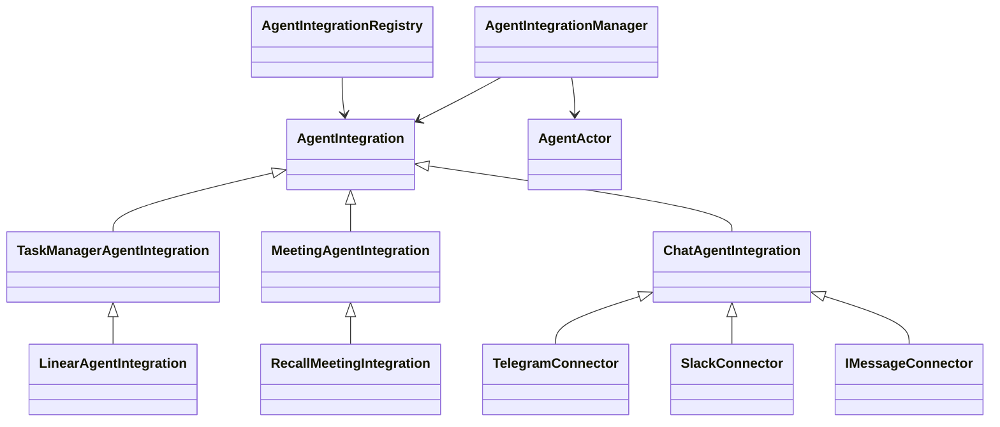

# Agent integrations

`AgentIntegration` is the application-facing runtime contract. One instance represents one installed identity for one agent. `AgentIntegrationManager` owns startup, shutdown, resume/reconnect, queues, actor sessions, and output subscriptions. Providers are constructed by `AgentIntegrationRegistry`; application callers do not cast them to a family or transport class.

## Contracts

| Contract | Owner and purpose |
| --- | --- |
| `connect`, `disconnect`, `isConnected`, `onEvent`, `onError` | Provider lifecycle and normalized input/response/hint events. The manager subscribes before connecting. |
| `resolveRoute` | Family chooses the stable external session key before the manager serializes work. The triggering interaction and reply target are separate fields. This hook performs no I/O. |
| `authorize`, `isAllowed` | Family supplies access policy. The manager enforces it before preparation/runtime work and rechecks it before sends and output delivery. |
| `sessionPolicy` | Family supplies timeout, session name, and metadata. The manager resolves the persisted mapping and operates through `AgentActor`. |
| `prepareInput`, `consumeInput` | Family builds context/attachments and can consume an interaction, such as a typed answer to an open question, without starting another turn. |
| `deliver` | Host emits runtime events, messages, typed `request-opened` / `request-resolved` outputs, and lifecycle notifications. `turn-completed` and `turn-failed` are terminal signals; a runtime `stream_end` remains a segment boundary. |
| `observeSession`, `releaseSession` | Passive family observation of manager-supplied activity and cleanup of delivery state. The manager owns the actor subscription; chat owns its indicator timers. |
| `getTools` | Family exposes optional tools through named, schema-described operations. Existing chat send/directory endpoints invoke these without accessing transport methods. |
| `onCreated` | Optional setup-only hook. iMessage uses it for the contact card; boot and reconnect never invoke it. |

The registry exposes serializable definitions (family, agent capabilities, management capabilities, setup fields, settings) before an installation is connected. Target classification can also be requested through the registry without constructing a connector. Each provider registers connection-independent `isAllowed` and `sessionPolicy` hooks; outbound session recording uses these against the current persisted installation even during a reconnect. Chat adapters and their registry entries share the same policy implementation.

## Chat behavior

`ChatAgentIntegration` owns `/clear`, Telegram's `/start`, sender attribution, input preparation, session naming, streaming delivery, working indicators, user-request cards, and chat tools. `chat-input.ts` contains the attachment download/upload and transcription path; `chat-delivery.ts` contains response formatting and streaming state. The concrete providers retain their protocol, threading, formatting, reaction, directory, and native-card implementations.

The normalized response event carries a request ID, request kind, and value. Chat-specific callback strings and question-answer envelopes are decoded in the chat family. The host retains actor-bound review submission, input claims, and stale-response checks. `emitEvent` awaits its subscribers: the host persists accepted inputs before returning, resolving an input to `accepted`, `duplicate`, `rejected` or `retry` ([Durable integration delivery](integration-delivery.md#acceptance-and-dispatch)), and processes responses inline. Shared delivery, retries and restart semantics are described in [Durable integration delivery](integration-delivery.md). The host logs and reports event-processing failures without changing connection status; connector errors still update status and notify the user. All chat events use `onEvent`.

## Message display

The agent's input never changes for display. `prepareInput` returns the model-facing
`text` and, separately, an optional `display`: the human request (text, author, time,
link), the source (conversation or work item, with a safe link, identifier, title,
workspace and status) and the event (`type` plus a label). Families build it from what
they already have: chat from the incoming message and provider hints (Slack adds the
avatar, workspace and permalinks, and the request text without injected thread
history), task managers from the event trigger and the issue snapshot (Linear adds
status, priority, people and labels). Payload IDs, file URLs and credentials stay out.

The manager adds the integration identity (ID, display-name snapshot, provider key,
family) and version, validates the card (`message-display-schema.ts`: https links
without credentials, bounded strings), and records the integration as the message's
author in `message_author` (`user_id` null, `integration_id` set, the card in
`display`) before the handoff. The row is keyed by the delivery ID, which is also the
message uuid (and `initialMessageUuid` for a new session). A retry upserts the same row,
moving it to a replacement session after self-heal; a failed or uncertain handoff keeps
it, since the runtime may have accepted the message. The messages API joins it onto the
user message as `integration` by exact uuid only; people's rows keep producing `sender`.
A message queued mid-turn keeps its uuid too: the CLI writes it as the queued command's
`source_uuid`, which becomes its transcript id. No message text is ever matched, so an
identical message typed in the app never picks up a card. Live watchers get the same
card in the `user_message` event. Author rows follow the existing `message_author`
lifecycle, now in every mode: forks re-key them, and session, agent and factory-reset
deletion remove them. A forked copy of a message queued mid-turn keeps its uuid, which
already keys the source's row, so it renders as text. A card that does not validate is
not stored, and the message renders as its text. Recording and broadcasting never block
delivery.

Only the host writes these rows, so a card cannot be spoofed by message text, and the
external text keeps its untrusted-input role. In the renderer, the `integration` kind
in `user-message-kinds` matches on this field alone and renders the provider's
`Message` from `setup-providers.tsx` (Slack message row, Telegram and iMessage bubbles,
Linear ticket preview), or a generic card for any other provider, including one this
version does not know. The card shows the platform, event, request and source link;
the full agent input sits behind a collapsed toggle. Messages from before this
metadata, and sends whose card was not stored, render as ordinary text.

## Runtime recovery and authorization loss

Families declare unfinished local work with `sessionsToRecover()`. The manager attaches host delivery before reconnecting the container stream, so terminal replay reaches the family even when no new external event arrives. Restoring unfinished sessions happens outside the integration-connect critical path; completed historical mappings do not start containers. Retries belong to those recovery demands and are cancelled when the integration or session is released.

The manager binds `IntegrationHost` before connection. Its `session(externalId)` reconciles a mapped stream and returns a session context with live read-only `activity` and `pendingRequests`. Unknown activity is not idle. Families use this narrow interface during dispatch/recovery; `observeSession` does not start containers or subscribe to runtime streams. The manager normalizes request notifications and uses the session wire for session-scoped requests, retaining the global wire only for agent-scoped review cards.

Inbound transports and outbound MCP credentials use `requireIntegrationReconnect` when authorization is definitively lost. The provider supplies its validated replacement config and the exact stored revision it invalidated. The shared transition clears credentials and saves disconnected status atomically, preserves pause, and ignores stale failures. The manager tears down its live connector and refreshes the agent's integration MCP projection. Transient transport errors remain recoverable; they cannot overwrite this terminal status.

## Persistence and compatibility

`agent-integration-service.ts` and `agent-integration-session-service.ts` own persistence. `store.ts` adapts their storage-facing records to neutral installation/session records; the physical `chat_integrations` and `chat_integration_sessions` tables and the `externalChatId` API field remain compatible. Existing IDs, credentials, approvals, timeout/model overrides, mappings, and transcripts stay in place. Chat reads its existing settings columns and keeps its existing session metadata flags.

The Slack provider factory supplies an installation-scoped store for joined-thread participation. `SlackConnector` saves its bounded thread list in `slack_thread_state` and restores it before accepting events, including when multiple threads share one agent session. The automatic migration preserves existing session rows; no integration reinstall is required.

Application startup, desktop resume, and API lifecycle calls use the same `agentIntegrationManager` singleton. Callers import the manager directly from `agent-integrations`; chat transports and fixtures use `ChatAgentIntegration` from the chat family. Existing chat HTTP paths and UI setup flows remain compatible. Discovery uses `list_agent_integrations`; historical tool calls retain their renderers.

## Integration-owned MCP

Providers may register `mcp(record)` to return an `IntegrationMcpConnection` without
constructing a live inbound connector. The integration owns credentials, refresh
and lifecycle; its `authorization()` callback must revalidate ownership and parent
state when called, including after asynchronous refresh. The shared MCP proxy
owns transport and audits. Its existing `remoteMcpId` records
`integration:<installation-id>` and `policyDecision` records `integration_identity`,
so attribution requires no additional audit column or migration.

Runtime projections expose these connections to every session of the owning agent
without creating a user-owned MCP account, assignment or independent
permission/delete control. Connect, pause and deletion refresh the running agent's MCP
environment. Pause claims lifecycle ownership before awaiting storage, and status
writes are serialized so an older resume or error cannot reopen a paused identity.
The provider reports authentication and availability changes through
its callbacks. Prompts explain the agent's identity and direct reconnection to the
parent integration. The host assigns installation-ID-based tool namespaces; the
container reserves those names against user MCPs. Only upstream network/protocol
failures affect outbound health, excluding caller cancellation and parent lifecycle
rejections. Ordinary requests authorize once; a real upstream handshake is followed
by a second check before forwarding the waiting tool call. Existing chat
providers do not opt in and retain their current outbound behavior.

## Management and discovery

`/api/agent-integrations` owns management for every provider; `/api/chat-integrations`
remains a compatibility URL. Persistence lives in `agent-integration-service.ts`
while the existing physical table names preserve installed accounts and sessions.
Provider definitions control safe serialization, management permission, settings,
cleanup, and reset-table ownership. Renderer providers register setup and optional
connection/settings panels; shared pages do not import concrete provider panels.

`list_agent_integrations` calls the agent-authenticated `/api/x-agent/integrations/list`.
It lists every account owned by the caller, its capabilities, active external session
IDs, and any integration-owned MCP identity/server/tools. Chat operations consume
chat capabilities; MCP providers use their named server. Credentials are excluded.

## Provider setup

Provider-level setup hooks run before a connector exists: `prepare`, optional
`testCredentials`, `authorize`, and `callback`. Generic HTTP routes authorize the
caller using the provider definition and delegate credential exchange/validation.
Create uses `POST /api/agent-integrations/agents/:id` with `{ provider, name, config }`;
authorization uses `POST /api/agent-integrations/:integrationId/authorize`. Provider
callbacks use `/api/agent-integrations/providers/:provider/callback`; the shorter
`/:provider/callback` path remains valid for previously registered callback URLs.
Callbacks require provider-validated, expiring one-use state instead of user cookies.

Telegram token validation, Slack bot/app-token checks, and iMessage code exchange
implement this same contract. Agent-side creation uses the same preparation hooks
and requires explicit provider opt-in, preserving owner-only interactive setup.
Initial authorization-required rows are inserted disconnected atomically.

Provider setup uses `IntegrationSetupLayout` for the shared header, instructions,
credential panel, fields, feedback and actions. Providers supply their content and
connection flow. An optional read-only `setup.describe` hook supplies app-creation
and callback URLs through the agent-scoped setup endpoint without creating an
installation. The endpoint enforces the same provider management role as creation.

## Transports

A provider receives events over its own connection (`direct`) or as webhooks
through the host's webhook relay (`relay`). Its definition lists the transports
it supports; `['direct']` when omitted. A provider without `direct` requires the
relay, so the setup UI hides it while `useWebhookRelay()` reports the relay
unavailable, and the setup endpoint publishes the provider's transports
alongside its links.

Which transport a connection uses is decided each time it connects, and never
stored. The manager hands the connector the relay in `host.relay` when the host
has one available at that moment, and nothing otherwise. A connector whose
webhooks are set up uses the relay when it's offered and connects directly when
it isn't; one whose webhooks aren't set up always connects directly, so
installations from before the relay keep working unchanged. A relay that comes
or goes while a connection runs changes nothing until its next connect (boot,
pause/resume, a settings change, or a health rebuild). Relay addresses are
treated as fixed: switching relay implementations breaks set-up webhooks, as it
does agent-minted webhook triggers.

"Webhooks are set up" is the stored config's `relay: { endpointId, url, scope }`,
plus whatever the provider keeps on its side (for Linear, the optional signing secret).
When provider setup returns `relay: true`, setup mints the endpoint before the
installation exists, under the creator's platform member (as agent-minted
webhook endpoints are), so provider setup can hand out its URL; a relay-only
provider always gets one. If the installation is then not created, the endpoint
is disabled. Deleting the installation disables it too, unless another
installation stores the same endpoint (Email's mailboxes share one per relay
scope).

`host.relay.attach()` goes through `integrationRelays`, which keeps one relay
registration per integration across reconnects: nothing is claimed while no
connection is attached, and events already claimed are offered to the next
connection as soon as it attaches. A relay connection is connected while it is
attached, so the delivery queue keeps running even while the relay itself is
down. Relayed events go through the same `emitEvent` handoff as direct input;
`relayAcceptResult()` maps its result to what the relay acknowledges (`rejected`
becomes `discard`; `retry` is never acknowledged).

iMessage sets its webhooks up itself, and with a relay it opens no socket. The
first connect offered a relay mints the endpoint, with a verification profile
for the gateway's signature and a secret the host generates. Every such connect
registers the endpoint as the phone's gateway webhook (`PUT`, which is
idempotent), then receives every event through the relay and sends commands
over the gateway's HTTP API. Existing installations switch on their next connect
with no step from the user. Without a relay, or if the endpoint or registration
fails, the connection uses the gateway socket for both directions as before,
acking each event once `emitEvent` resolves to anything but `retry`. The
registered webhook stays in place, so events the socket misses wait on the
relay for a later connect.

The webhook takes every event type the gateway would otherwise hold for a
socket, since held events count toward the gateway's 1,000-event cap. Events
are handled one at a time and deduplicated on the gateway event id; messages
are also deduplicated by the delivery queue on their message id. Send
confirmations arriving through the relay are ignored. Instead, each HTTP send
returns Linq's message id, and a reaction answers an approval only if it is on
that approval's own message, so a stale reaction can't answer a newer approval.
Deleting the installation removes the gateway webhook before the endpoint is
disabled.

Email works the same way, with no SSE stream when a relay is offered, but its
webhooks only wake the cursor poll, which stays the source of truth. Its
mailboxes share one endpoint per relay scope, so they don't attach through
`integrationRelays`. `EmailRelays` keeps one registration per endpoint and
routes each pointer to its mailbox. See [agent-email.md](agent-email.md#consumption-and-delivery).

Telegram sets its webhook up itself too, and with a relay it doesn't poll. A
bot has either a webhook or `getUpdates`, and Telegram holds what it can't
deliver for 24 hours. The first connect offered a relay mints the endpoint and
a secret. Every such connect calls `setWebhook` with the endpoint, which is
idempotent and moves updates held for `getUpdates` to the webhook. Without a
relay, or if the endpoint or `setWebhook` fails, the connection long-polls.
grammY deletes the webhook before its first `getUpdates`, keeping held updates.
Updates an earlier webhook already posted to the relay can't come back through
`getUpdates`, so a connection that has an endpoint but couldn't set the webhook
also drains the relay alongside the poll. A connection replaced during setup
sends no `setWebhook`, and one already in flight is waited out by its disconnect
and by the installation's next connect, before that one touches Telegram. The
manager stops waiting for a teardown after five seconds, so the disconnect alone
isn't enough. A stale webhook can't land after the next connection has chosen
to poll.
Telegram doesn't sign its posts. It sends back the webhook's `secret_token` in
a header, which no relay verification profile can check (they all sign the
body), so the host compares it itself. The token is the secret bound to the
bot's id, so a bot the installation no longer uses can't post as the current
one. Relayed updates go through `bot.handleUpdate()` one at a time, into the
same handlers as polled ones, without the first-poll batching, and are
deduplicated on `update_id` for as long as the installation keeps its cards.
Each reports what `emitEvent` did with its message.
Open cards and their buttons belong to the installation, not the connection,
so a tap that arrives after a reconnect still answers. A restart forgets them,
and callback ids are random, so an old card's button can't match a new card. Deleting the installation deletes the
bot's webhook if it still points at the endpoint, before the endpoint is disabled.

Slack can't set its webhooks up itself. A Slack app delivers over Socket Mode
or to request URLs, never both, and only the app's owner can switch it in
Slack. So webhooks are explicit:
- New installations, when the host has a relay: "Create app in Slack" creates
  the installation first. `prepare()` returns `relay: true` and status
  `disconnected`, with no bot token yet. Slack's create-app page then opens
  with a manifest whose Event Subscriptions and Interactivity post to the
  endpoint, with Socket Mode off. Pasting the app's signing secret and bot
  token connects it. No app-level token is needed.
- Existing Socket Mode installations: the Event Delivery card's "Set up
  webhooks" takes the signing secret and mints the endpoint. The card then
  walks the owner through switching the app in Slack. "Remove webhooks" goes
  back to Socket Mode, with an app-level token.

The endpoint carries a Slack v0 verification profile (`slackVerificationProfile`),
so forgeries are refused as they arrive. The host verifies each post again with
`isValidSlackRequest`, as of the post's `received_at`, because a claim can come
long after the post, and because Slack's URL check skips the endpoint's
verification. A post that fails the host's check but that the endpoint
verified was signed with the previous secret (it arrived before a rotation),
so it is still handled; it just doesn't count toward `webhookStatus`.

A connection with webhooks keeps Socket Mode (when it has an app-level token)
until a post the host itself verifies arrives through the relay. Slack signs
its URL check, so saving the request URL is enough. That post records
`webhookStatus: 'verified'` and closes the socket; later connections receive
through the relay only. Until then the socket is what reports the connection's
health, and a socket that fails to open keeps retrying while the relay stays
attached for that first post. A signed URL check that fails verification
records `rejected`, and the card asks for the secret again; an unsigned one
isn't Slack's and changes nothing. Saving a signing secret, even the same one,
clears the status and gives the endpoint that secret. Finishing a webhook-first
installation checks its bot token with `auth.test` before saving it.

Without a relay, a verified installation has nothing to receive through, so its
connect fails, and the manager retries it as it would through a network
outage. Relayed bodies go through `app.processEvent()`, into the same Bolt
handlers as Socket Mode. They are deduplicated on `event_id` / `trigger_id`.
Answer buttons carry their request in the button value, so a click that
reaches another connection, or arrives after a restart, still answers.

## Task managers

`TaskManagerAgentIntegration` maps each work item to a session and prepares issue
context and reply guidance. Inputs go directly through the same manager/runtime queue
as chat messages, including while a turn is running. Its family has no separate
durable work queue, turn lock or retry scheduler; the shared manager owns delivery
durability for all integrations. Linear implements provider setup, cleanup and MCP hooks;
its UI panels register at the renderer composition point.
See [Linear integration](linear-agent-integration.md) for event delivery and identity setup.

## Meetings

`MeetingAgentIntegration` brings the agent into a video call as a voice participant: one
session per meeting, a join brief, status tracking, and tools to join, leave, list and post
chat. Providers implement only `MeetingBotHost`; the voice loop runs in the participant page
the bot presents as its camera. Integration tools can opt into management invocation
(`exposure: 'management' | 'both'`) and are then reachable at
`POST /api/agent-integrations/:id/tools/:tool`, so the join button and the agent's
`join_meeting` call the same operation. See [Meeting integrations](meeting-integrations.md).
