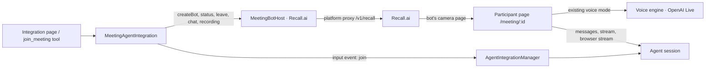

# Meeting integrations

An agent can attend a video call (Zoom, Google Meet, Microsoft Teams) as a voice participant. This is the `meeting` family of [agent integrations](agent-integrations.md); the provider is Recall.ai, reached through the platform proxy.

## Shape

Three parts, each knowing little about the others:

- **The family** (`src/shared/lib/meeting-integrations/`). `MeetingAgentIntegration` owns the meeting lifecycle: one agent session per meeting, the join brief, status tracking, and the tools (`join_meeting`, `leave_meeting`, `list_meetings`, `send_meeting_chat`, plus the people-only `get_meeting_recording`). It talks to a provider only through `MeetingBotHost`: create a bot, read its status, leave, post chat, fetch a recording link. The family contains no voice code and no provider payloads.
- **The provider** (`recall/`). `RecallBotHost` maps the host operations onto Recall.ai's bot API and its status codes onto the family's phases (`requested → joining → waiting_room → in_call → ended | failed`). The installation stores no credential: `resolveRecallTransport` reaches Recall through the platform proxy (`/v1/recall`, bearer = the platform token attributed to the meeting's owner, so bot time is billed to them) or, for a self-hosted deployment, directly with a host-wide `RECALL_API_KEY`. The platform side is `apps/proxy/src/services/recall.ts` in the platform repo: an allowlist of four routes, a rebuilt create body, per-org bot ownership and bot-minute billing.
- **The participant page** (`/meeting/:meetingId?token=…`, `src/renderer/components/meeting/`). Recall runs it in a headless browser inside the call as the bot's camera; there, the microphone is the room's audio and whatever the page plays is the bot's voice. The page mounts the app's existing `useVoiceMode` against the meeting's agent session, so whichever voice engine the deployment configures runs unchanged. Its render is what participants see: the agent's orb, name and state, its own words as subtitles, the roster, and the agent's browser or latest delivered image when there is one.

## Availability

A meeting bot is a browser on Recall's infrastructure loading this app, so the deployment needs an address the internet can reach, and a way to Recall. Both are decided by the provider itself (`IntegrationProvider.isAvailable()`, here `meetingAvailability`), not by the UI:

- `HOST_PUBLIC_URL` must be set to an https address that is not loopback or private (`resolveInternetAppBaseUrl`). Trusted origins and request hosts are not used: they say where browsers come from, not where Recall can reach us.
- The platform must be connected (or `RECALL_API_KEY` set).

The voice provider is deliberately not a condition. With a provider that has no Live engine (Deepgram) the page runs the chained engine in the call: it has no room policy, so it treats everything it hears as addressed to the agent and speaks more than the room wants, but the agent is in the meeting and working. The voice picker is simply absent for such a provider.

`GET /api/agent-integrations/providers` lists only the providers the deployment can host; the setup picker offers those and creation refuses the rest. Electron is never eligible. The same mechanism gates Email on a platform connection.

## Join flow

1. A person pastes an invite link on the integration page. The generic route `POST /api/agent-integrations/:id/tools/:tool` invokes the family's tool; tools opt into management invocation with `exposure: 'management' | 'both'`, so the same operation could serve the agent too, though no agent-facing route exposes it yet and the agent's integration instructions say so. Refusals are `IntegrationPolicyError`s and come back as 400 with their message; anything else is a reported fault.
2. The family validates the link (`parseMeetingUrl`, real platform hosts only). Asking for a call this installation already has a bot in returns that meeting; different agents may each bring a bot into the same call. Otherwise it stores a meeting row and emits an input event to itself. The manager creates the agent session through its normal path with the brief as the first message (platform and purpose; never the invite link, which carries the passcode) and the meeting guidance as the session prompt, followed by the installation's standing instructions when it has any (`instructions` in the Recall config, edited on the integration page; bounded by `MEETING_INSTRUCTIONS_MAX_CHARS`); `observeSession` records the session id on the meeting.
3. The family asks the host for a bot whose camera page is `<HOST_PUBLIC_URL>/meeting/<id>?token=<one-time token>`.
4. Status is polled every five seconds while the meeting is open. Transitions are compare-and-set and terminal states are final, so a late poll cannot reopen an ended meeting. Losing the host for `MAX_CONSECUTIVE_POLL_FAILURES` polls is reported on the row, not treated as the end of the meeting: the bot may still be in the call, so polling continues, Leave still reaches it, and the age limit closes it if the host never answers. Two join requests for the same call made at once share one bot (`pendingJoins`), and a leave that lands while the host is still starting the bot keeps the row open (`cancelRequested`) so the join can send that bot home as soon as it exists; if the host cannot be reached at that moment the row stays open and tracked, so Leave can be repeated. Webhooks can replace polling behind the same `transitionMeeting`. Rows older than `MAX_MEETING_AGE_MS` (24 h) are closed on reconnect, with the bot asked to leave in case it is still there.
5. The moment the bot is in the call it posts a disclosure into the chat (`meetingRecordingDisclosure`): what it is and that the audio is recorded and kept for `MEETING_RECORDING_RETENTION_HOURS` (7 days).
6. When the call ends (or the bot could not join), the family emits an `ended` input so the agent can deliver notes or a summary in the same session. Deleting the installation sends any bot still in a call home (`leaveOpenMeetings`); a bot alone in a call nobody ended leaves after `automatic_leave.everyone_left_timeout` (30 s).

## How the agent takes part

A meeting has a `mode` (`MEETING_MODES` in `schemas.ts`), chosen per call on the join form (and accepted by the `join_meeting` tool), defaulting to the installation's setting:

- **voice**: the participant described everywhere else in this document. Speaks when addressed; the tile shows the orb, its browser, delivered images and spoken subtitles; files go into the chat.
- **silent**: hears the room, never speaks. The Live policy (`MEETING_SILENT_LIVE_POLICY`) tells the model not to produce speech and the participant page mutes the call audio regardless (`setOutputMuted`), since GPT-Live has no text-only output. The family posts each of the agent's written messages into the call's chat at message boundaries (`deliverWrittenReply`: on the next message starting, a tool starting, or the turn ending), and the tile subtitles the latest written reply. Browser and images still show.
- **listen**: the room gets nothing. The Live policy (`MEETING_LISTEN_LIVE_POLICY`) makes the model a relay: it delegates what the brief and standing instructions ask it to watch for, without waiting to be addressed. The page shows the name and "Listening in" only, `deliver()` posts nothing (not even files), and the person reads the session in the app. The recording disclosure is still posted on join: the audio is still kept.

The agent's session prompt (`meetingSessionRules(mode)`) and join brief say the same in the agent's terms, so it writes for the chat, or for the person, instead of for a listener.

**No play-by-play.** Backend text reaches the voice model the same way as in one-on-one voice mode: every streamed message as `session.thinking.append`, then the completion cue. What keeps a meeting bot quiet is the policy alone (`MEETING_LIVE_POLICY.spokenUpdates`): a thinking update never triggers speech, the cue is the one moment to give the outcome, and errors or requests for a person's input are the only other reasons to talk. The first real meeting (2026-10-14) narrated progress under an earlier, softer wording; if the tightened wording is not enough, the deterministic alternative is to hold streamed text in the Live session until the turn ends and forward only the last message (tried, then set aside as too blunt: the model would have no mid-turn context at all).

**Voice.** The installation's `voice` is an opaque id of the configured voice provider's Live engine: the host reports the provider's `getLiveVoices()` on `/api/voice/configured` (`liveVoices`, a different list from read-aloud `voices`), the settings card offers only those, and the id travels in the `LiveConversationSetting`. The provider resolves it at mint time (`resolveLiveVoice`: the OpenAI provider accepts the GPT-Live voices in `openai-live-voices.ts` and falls back to Marin), so a change applies to the next meeting and a voice stored under another provider is simply the default.

## Recording

Recall only reports who is in the call while it records, and the recording is what the integration page later links to, so the bot records the room's mixed audio (`video_mixed_layout: 'audio_only'`, no video) with a 7-day retention. The participant page's bootstrap response includes `recordingRetainedUntil`; while it is in the future the integration page offers a play button that calls `get_meeting_recording`, fetches a fresh link from Recall (links are signed for six hours and never cached) and opens it.

## The page's credential

The page runs in a browser nobody is signed into. In a deployment without accounts that is the end of it. With accounts (`AUTH_MODE`), every route the page uses (the session's messages and stream, the voice routes, the browser stream, inline files) wants a user. The bootstrap `GET /api/meeting-participant/:id?token=…` therefore sets an http-only, same-site cookie (`participant-credential.ts`) that `Authenticated()` accepts in place of a session, on the requests the page needs and nowhere else (`meetingParticipantMayRequest`: reading its own `sessions/:sessionId`, posting to its `messages` and `interrupt`, reading `files` and `browser/status`, and the voice routes; no other session write such as fork, capability review or account provisioning, no listing or creating sessions, no browser actions, no file writes). There it stands for the person who started the meeting (`createdByUserId`, so Live minting and billing are attributed to them); the agent-role middlewares confine it to the meeting's agent and session, as a `user`, never an owner, and every grant decided by account rather than agent role (`IsAdmin`, `EntityAgentRole`, `OwnsAccount` and the like) refuses it. Any other route answers 403, so the credential never acts as the person elsewhere in the app. `authenticateAgentWebSocket` accepts it as a viewer for the browser stream. The credential lives as long as the meeting row is open; the `AuthGate` and the 401 handler leave `/meeting/:id` alone (`isMeetingParticipantPage`).

Threat model: whoever holds the page URL holds the credential, and the page token travels in query strings (the page URL, the events URL, the stream), so it appears in the bot host's view of the create request and in this app's access logs. What it buys is bounded by the above: one meeting's session, as a user, for the length of the call.

## Voice in a room

`POST /api/voice/live/agents/:id/session` accepts an optional `sessionId`. The host asks `resolveLiveConversationSetting(agentSlug, sessionId)` whether an integration owns that session; the owning provider's `liveSetting(record, externalId)` returns a `LiveConversationSetting`: a turn-taking and spoken-update policy that replaces the one-on-one rules, and standing instructions about the place. The Live prompt module knows no family; the meeting family builds its setting in `meetingLiveSetting` (`MEETING_LIVE_POLICY`: one participant among several, default to silence, speak only when addressed by name or asked, answer once and hand the floor back, treat the completion cue as "stay quiet unless the room has not heard the outcome"). Its instructions name the call and the bot, then the installation's standing instructions, then the brief for this call, then the roster. The provider passes the standing instructions in from its own config (`recallProvider.liveSetting`), so an edit on the integration page reaches the next minted voice session. The browser cannot claim a setting.

**Who is in the room.** The host posts participant join, leave and update events to `POST /api/meeting-participant/:id/events/?token=…` (the same one-time token as the page; Recall needs the trailing slash before the query; bodies are capped at 16 KB). The provider translates its payload through `MeetingBotHost.parseEvent`; the family keeps an in-memory roster per meeting (`meetingRoster`), never listing the bot itself, clears it when the call ends, and sweeps idle unwatched rooms after four hours (a late webhook after a restart would otherwise leave one behind). The participant page follows `GET /api/meeting-participant/:id/stream` and, on every change, appends a roster instruction to the running voice engine through the generic `appendInstructions` channel: with two or more people the group rules apply, with exactly one the model is told it is in an ordinary one-on-one conversation and should answer everything, with none it stays silent. The setting handed to the host at mint time includes the roster, so a reconnect starts informed.

The camera shows the agent's orb, the agent's own speech as a two-line rolling subtitle (other people's words are never shown), and the latest image the agent handed over with `deliver_file`, which stays until the next image replaces it. While the session's browser is open, the camera shows it live instead (`MeetingBrowserCard`): the chat tray's tab strip, toolbar and screencast canvas over the same `useBrowserStream` socket, read-only and without the stop and full-screen controls. The browser stream proxy (`BrowserFrameRelay`) holds frames back while the viewer's link is congested and sends the newest once it drains, so a remote viewer never falls seconds behind and still ends on the page's current state. Files follow the same convention as the chat and email families: the family's `deliver()` watches the session's `tool_result_ready` events for `deliver_file` and posts each file into the meeting chat as a link to the app's file route, since a bot cannot drop bytes into a call. `send_meeting_chat` stays for plain text.

## Storage

`agent_integration_meetings` holds the meeting URL, platform, bot id, status, session id, the person's brief and the hash of the participant token. The existing `chat_integration_sessions` mapping (external id = meeting id) still owns session routing, so manager recovery and session visibility apply unchanged. The provider lists the table in `storage()` for reset and deletion order.

## Running it

- Set `HOST_PUBLIC_URL` to the public https address of the app. The tunnel must pass server-sent events through unbuffered, because the participant page reads agent replies from the session stream. Tailscale Funnel (`tailscale funnel --bg --https=443 <port>`) and ngrok do. Cloudflare quick tunnels (`cloudflared tunnel --url`) buffer the stream indefinitely: the bot joins and hears you, but never receives the agent's answer.
- Connect the platform (or set `RECALL_API_KEY`, optionally `RECALL_REGION`, for a self-hosted Recall account).
- Voice must be configured (Settings → Voice) with a provider whose conversation engine runs in the browser; OpenAI Live is the one validated here. The summarizer model must also be reachable: `/api/voice/live/map` runs on it, and a missing key there shows up as "Voice mapping failed" and dropped delegations.
- Meet and Zoom bots wait in the waiting room until a participant admits them.

## Known gaps

- The chained (STT + TTS) engine forwards every finalized utterance to the agent; in a room it needs an addressed-by-name gate before it is useful. The Live engine still backchannels occasionally despite the policy; a session-level fallback (automatic responses off plus an addressed-by-name gate) is the next thing to try.
- Status via Recall webhooks instead of polling (also what the proxy's rate limits would prefer).
- Agent-initiated joins, chat posts and leaves: the family's tools exist and the management route invokes them, but no x-agent route exposes them to the agent, so its integration instructions tell it a meeting is started from the integration page. Adding the route means an agent-container tool and the x-agent policy check, nothing in the family.
- Screen sharing (probed 2026-10-12 on Zoom, `web_4_core`, two bots): Recall's `output_media.screenshare` takes a webpage like the camera does, and it renders, but the bot runs **one output page at a time**. Starting the screenshare mid-call (`POST /bot/:id/output_media/`) kills the camera page, and the bot's microphone follows the live page, so the voice session in the camera page dies with it. Filling both slots at create time leaves the screenshare page frozen after load (black share) until it is restarted. After any screenshare cycle, `POST` for the camera returns 200 but the page never loads again, in any stop/start order; the screenshare slot restarts fine. Consequence for "share the agent's browser": the live browser view has to render inside the one page that owns the voice session, which is why it lives on the camera tile (people can pin the tile). A true screen share would need the whole participant page, voice included, to move to the screenshare slot, with a fresh Live session and no way back to a camera tile.
- Speaker attribution: the roster path already parses Recall's `speech_on`/`speech_off` events; adding them to the requested webhook events and appending "[Name] is talking" context to the voice model would give who-asked-what without re-feeding transcripts. Per-participant audio streams and real-time transcripts (which Recall exposes to the page over `wss://meeting-data.bot.recall.ai`) remain a later spike.
